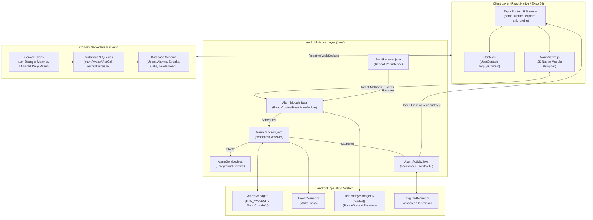
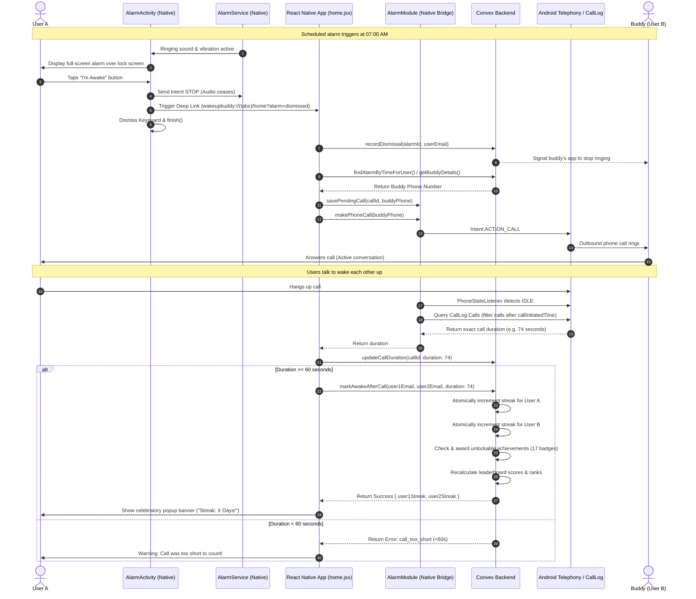
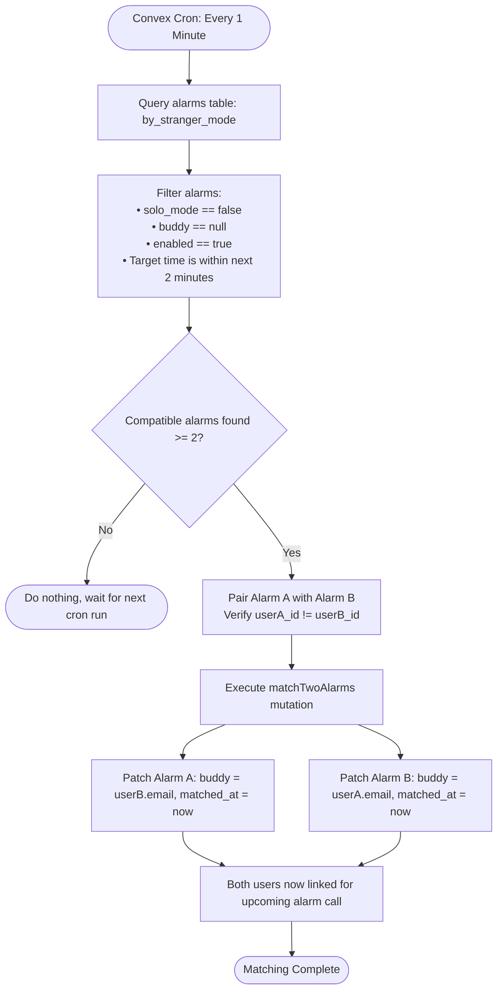

# 🌅 WakeupBuddy — Social Accountability Alarm Clock

> **"Wake up together, stay accountable."**  
> WakeupBuddy transforms waking up from a solitary battle against sleep inertia into a synchronized social contract. By linking real-time alarms with automated telephone calls, peer accountability, and gamified streak economies, WakeupBuddy ensures you never hit snooze again.

---

[](https://reactnative.dev/)
[](https://expo.dev/)
[](https://convex.dev/)
[](https://developer.android.com/)
[](./LICENSE)

---

## 📑 Table of Contents

- [1. Motivation & The Psychology of Social Waking](#1-motivation--the-psychology-of-social-waking)
- [2. System Architecture](#2-system-architecture)
- [3. A to Z End-to-End Control Flow](#3-a-to-z-end-to-end-control-flow)
- [4. Architectural & UML Diagrams](#4-architectural--uml-diagrams)
  - [4.1 Component Architecture Diagram](#41-component-architecture-diagram)
  - [4.2 A-to-Z Sequence Diagram (The Alarm-to-Call-to-Streak Loop)](#42-a-to-z-sequence-diagram-the-alarm-to-call-to-streak-loop)
  - [4.3 Android Native Lock Screen Ring Lifecycle](#43-android-native-lock-screen-ring-lifecycle)
  - [4.4 Autonomous Stranger Matching Engine Flowchart](#44-autonomous-stranger-matching-engine-flowchart)
  - [4.5 Convex Database Entity-Relationship (ER) Diagram](#45-convex-database-entity-relationship-er-diagram)
- [5. Core Feature Specifications](#5-core-feature-specifications)
- [6. Application Screen Flow & UI Navigation](#6-application-screen-flow--ui-navigation)
- [7. Android Native Modules & Hardware Deep-Dive](#7-android-native-modules--hardware-deep-dive)
- [8. The 60-Second Anti-Cheating Verification Engine](#8-the-60-second-anti-cheating-verification-engine)
- [9. Gamification, Heatmaps & Dual Leaderboards](#9-gamification-heatmaps--dual-leaderboards)
- [10. Unlockable Achievements Catalog (All 17 Badges)](#10-unlockable-achievements-catalog-all-17-badges)
- [11. Android System Permissions Matrix](#11-android-system-permissions-matrix)
- [12. Project Directory Structure](#12-project-directory-structure)
- [13. Local Setup & Build Instructions](#13-local-setup--build-instructions)
- [14. Moderation, Reporting & Appeals System](#14-moderation-reporting--appeals-system)
- [15. Authors & Acknowledgments](#15-authors--acknowledgments)

---

## 1. Motivation & The Psychology of Social Waking

### The Sleep Inertia & Snooze Paradox
Traditional alarm clocks suffer from a fatal flaw: **the isolated self-bargain**. When waking up, the human brain experiences *sleep inertia*—a temporary state of impaired cognitive and sensory motor performance. In this vulnerable state:
- The prefrontal cortex (responsible for long-term rational planning) is suppressed.
- The limbic system (seeking immediate comfort and dopamine) dominates.
- A user can effortlessly swipe "Snooze" with zero social or cognitive consequence, repeating the cycle and destroying their morning schedule.

### The WakeupBuddy Solution
WakeupBuddy replaces the solitary reflex with **external peer accountability**:
1. **The Social Contract**: You are not waking up alone; a friend or an assigned stranger is scheduled to wake up at the exact same minute.
2. **Synchronized Ringing**: When the alarm fires, both devices activate simultaneously with lock-screen takeovers.
3. **Automated Live Telephone Calls**: Upon tapping **"I'm Awake"**, the app immediately places a phone call to your buddy.
4. **Verbal Cognition**: Live human conversation activates the prefrontal cortex within seconds, completely breaking sleep inertia.
5. **The 60-Second Anti-Cheating Barrier**: The app monitors the Android system call log. Both users **must talk for at least 60 seconds** to earn streak progression, leaderboard points, and badges. Hanging up early invalidates the wake-up!

---

## 2. System Architecture

WakeupBuddy is built on a four-tier hybrid architecture combining cross-platform JavaScript, native Android operating system services, a real-time cloud database, and external device APIs.

```
┌────────────────────────────────────────────────────────────────────────┐
│                        REACT NATIVE APPLICATION LAYER                  │
│   Expo SDK 54  •  Expo Router v6  •  Reanimated v4  •  Contexts (User/Popup)│
└───────────────────▲────────────────────────────────────▲───────────────┘
                    │ React Native Bridge                │ Convex React Client
                    │ (AlarmModule & NativeEventEmitter) │ (WebSocket / HTTP)
┌───────────────────▼────────────────────────┐ ┌─────────▼───────────────┐
│         ANDROID NATIVE SERVICE LAYER       │ │  CONVEX SERVERLESS BAAS │
│ • AlarmManager (Exact Alarm Clock info)    │ │ • Realtime Reactive DB │
│ • AlarmReceiver (Dual WakeLocks)           │ │ • Automated Crons (1m) │
│ • AlarmService (Foreground sound/vibrate)  │ │ • Leaderboard Engine   │
│ • AlarmActivity (Lockscreen UI & deep link)│ │ • Stranger Matchmaker  │
│ • TelephonyManager & CallLog inspection   │ │ • Streaks & Badges     │
│ • BootReceiver (Auto-rearm on boot)        │ └─────────────────────────┘
└───────────────────▲────────────────────────┘
                    │ System IPC
┌───────────────────▼────────────────────────────────────────────────────┐
│                       ANDROID HARDWARE / OS KERNEL                     │
│  PowerManager  •  KeyguardManager  •  Telephony  •  Telecom  •  Audio  │
└────────────────────────────────────────────────────────────────────────┘
```

- **Client Presentation**: React Native 0.81.5 with Expo SDK 54, utilizing `expo-router` for file-based routing and deep-link routing.
- **Native OS Bridge (`com.anonymous.WakeupBuddy`)**: Custom Java layer interfacing with Android's `AlarmManager`, `PowerManager`, `TelephonyManager`, and `NotificationManager`.
- **Backend & Cloud Engine**: Convex real-time database with fully reactive subscriptions, live mutations, and high-frequency scheduled crons.
- **Identity & Avatars**: Password hashing with `bcryptjs`, and dynamic vector avatar rendering via the **DiceBear Adventurer API**.

---

## 3. A to Z End-to-End Control Flow

From the instant a user signs up to the moment their streak increment updates on the global leaderboard, here is the complete end-to-end lifecycle:

```
[1. Auth & Onboarding] ──► [2. Permission Grant] ──► [3. Alarm Configuration]
                                                              │
                                     ┌────────────────────────┴────────────────────────┐
                                     ▼                                                 ▼
                             [Solo Mode]                                     [Buddy Mode / Stranger Mode]
                                     │                                                 │
                                     │                                      [Convex 1-Min Cron Matches]
                                     │                                                 │
                                     └────────────────────────┬────────────────────────┘
                                                              ▼
                                               [4. Native Alarm Scheduled]
                                              (AlarmManager RTC_WAKEUP)
                                                              │
                                                              ▼
                                               [5. Alarm Trigger Event]
                                              (AlarmReceiver acquires locks)
                                                              │
                                                              ▼
                                              [6. Foreground Service & Sound]
                                            (AlarmService loops notification)
                                                              │
                                                              ▼
                                               [7. Lockscreen AlarmActivity]
                                             (Turns screen ON over keyguard)
                                                              │
                                                              ▼
                                                [8. User Taps "I'm Awake"]
                                                              │
                                     ┌────────────────────────┴────────────────────────┐
                                     ▼                                                 ▼
                              [Solo Alarm]                                       [Buddy Alarm]
                                     │                                                 │
                                     │                                     • AlarmService stopped
                                     │                                     • recordDismissal signals buddy
                                     │                                     • Deep link opens React Native
                                     │                                     • ACTION_CALL placed to buddy
                                     │                                     • Call duration tracked via CallLog
                                     │                                                 │
                                     │                                          Duration >= 60s?
                                     │                                        ┌────────┴────────┐
                                     │                                     YES│                 │NO
                                     │                                        ▼                 ▼
                                     │                              [markAwakeAfterCall]   [Streak Denied]
                                     │                                        │
                                     └────────────────────────┬───────────────┘
                                                              ▼
                                             [9. Atomic Streak & Heatmap]
                                                              │
                                                              ▼
                                            [10. 17-Badge Achievement Engine]
                                                              │
                                                              ▼
                                             [11. Leaderboard Recalculation]
                                             (Daily reset at 18:30 UTC)
```

### Detailed Phase Breakdown

#### Phase 1: Onboarding & Hardware Permissions
1. User signs up with name, email, phone number, username, and password (hashed with `bcryptjs` salt rounds).
2. The user is redirected to `PermissionsGuide.jsx`. Android enforces strict background execution restrictions. The app requests:
   - `SCHEDULE_EXACT_ALARM`: Enables millisecond-accurate scheduling without Doze mode delays.
   - `REQUEST_IGNORE_BATTERY_OPTIMIZATIONS`: Whitelists WakeupBuddy from system memory pruning.
   - `SYSTEM_ALERT_WINDOW` (`canDrawOverlays`): Permits drawing above other applications.
   - `USE_FULL_SCREEN_INTENT`: Authorizes high-priority incoming call-style notifications on Android 14+.
   - `CALL_PHONE` & `READ_CALL_LOG` / `READ_PHONE_STATE`: Permits outbound dialing and call duration tracking.

#### Phase 2: Alarm Creation & Scheduling
1. User opens `alarm-editor.jsx` and configures:
   - **Time & AM/PM**: Stored in 12-hour format string and mapped to 24-hour millisecond timestamps.
   - **Repeat Days**: Array of 7 integers (`0 = Monday, ..., 6 = Sunday`).
   - **Mode Selection**:
     - **Solo Mode**: Traditional standalone alarm.
     - **Buddy Request**: Explicit pairing with a friend via email.
     - **Stranger Mode**: Unmatched pool flag (`solo_mode = false`, `buddy = null`).
2. The alarm is stored in Convex's `alarms` table.
3. The React Native bridge executes `AlarmNative.scheduleAlarm()`, invoking `AlarmManager.setAlarmClock()`.
4. Alarm metadata is written to Android `SharedPreferences` (`WakeupBuddyAlarms`) for persistence across phone reboots.

#### Phase 3: Autonomous Stranger Matching Engine
1. Convex executes an automated background cron (`stranger-alarm-matching`) **every 60 seconds**.
2. The query scans for all active stranger alarms scheduled within the next 2 minutes.
3. Matching criteria:
   - Identical target time and AM/PM.
   - Active and enabled (`enabled = true`).
   - Different users (`user1 !== user2`).
4. Once two users are matched, Convex executes `matchTwoAlarms`, assigning each other's email to the respective alarm's `buddy` field and populating `matched_at`.

#### Phase 4: Alarm Triggering & Native Awakening
1. The exact millisecond arrives. Android OS emits an explicit broadcast Intent to `AlarmReceiver`.
2. `AlarmReceiver` activates two concurrent power management locks:
   - `PowerManager.PARTIAL_WAKE_LOCK`: Keeps the CPU running at full speed.
   - `PowerManager.FULL_WAKE_LOCK | ACQUIRE_CAUSES_WAKEUP`: Forces the hardware display to turn on.
3. `AlarmReceiver` starts `AlarmService` as a **Foreground Service** with high priority, playing the alarm audio and pulsing the haptic vibration motor.
4. `AlarmReceiver` launches `AlarmActivity` directly over the secure lock screen using `FLAG_SHOW_WHEN_LOCKED`, `FLAG_TURN_SCREEN_ON`, and `FLAG_DISMISS_KEYGUARD`.

#### Phase 5: Alarm Dismissal & Inter-Device Handshake
1. The user taps the **"I'm Awake"** button on `AlarmActivity`.
2. `AlarmActivity` sends an intent to `AlarmService` with action `"STOP"`, instantly cutting audio and vibration.
3. If the alarm has a buddy:
   - `recordDismissal` mutation inserts an entry into `alarmDismissals`.
   - The buddy's app (which polls or reactively watches `shouldStopAlarm`) receives the signal and stops ringing.
4. `AlarmActivity` fires a deep link:
   ```
   wakeupbuddy://(tabs)/home?alarm=dismissed&buddy=<buddyEmail>&alarmId=<alarmId>&time=<time>&ampm=<ampm>
   ```
5. `AlarmActivity` calls `requestDismissKeyguard()` and finishes itself.

#### Phase 6: Automated Dialing & Call Verification
1. `home.jsx` intercepts the deep link.
2. If Solo mode: `markAwake()` is triggered immediately, crediting the streak.
3. If Buddy mode:
   - `home.jsx` resolves the buddy's registered phone number via `convexClient.query(api.users.getUserByEmail)`.
   - `createCall` records a pending call record in Convex.
   - Native method `savePendingCall` saves the pending call ID and timestamp to Android `SharedPreferences`.
   - Native method `makePhoneCall` invokes Android's `Intent.ACTION_CALL`.
   - `PhoneStateListener` listens for `CALL_STATE_OFFHOOK` (call answered) and `CALL_STATE_IDLE` (call hung up).
   - Once the call terminates, the native layer queries Android's `CallLog.Calls.CONTENT_URI` to extract the exact duration in seconds of the outbound call made after the initiation timestamp.
   - `updateCallDuration` syncs the real call duration to Convex.

#### Phase 7: Streak Verification, Gamification & Ranking Updates
1. The duration is evaluated:
   - **If duration < 60 seconds**: The mutation returns `status: "call_too_short"`. Streaks are **not** updated.
   - **If duration >= 60 seconds**: `markAwakeAfterCall` executes atomically for **both** users.
2. The user's daily record in `streaks` is created or incremented.
3. `current_streak` and `max_streak` are updated on the user model.
4. The 17-achievement engine checks unlock thresholds (e.g., 3-day, 7-day, 100-day streaks, total wakeups, buddy connections).
5. `updateLeaderboardForUser` computes points and updates rankings in the `leaderboard` table.
6. A scheduled cron resets daily metrics at **18:30 UTC (Midnight IST)** every night.

---

## 4. Architectural & UML Diagrams

### 4.1 Component Architecture Diagram



---

### 4.2 A-to-Z Sequence Diagram (The Alarm-to-Call-to-Streak Loop)



---

### 4.3 Android Native Lock Screen Ring Lifecycle

```mermaid
flowchart TD
    START([AlarmManager RTC_WAKEUP Fires]) --> AR[AlarmReceiver.onReceive]
    AR --> WL1[Acquire PARTIAL_WAKE_LOCK<br/>CPU kept running for 10s]
    AR --> WL2[Acquire FULL_WAKE_LOCK | ACQUIRE_CAUSES_WAKEUP<br/>Screen hardware turned ON]
    
    WL1 & WL2 --> FS[Start AlarmService Foreground Service]
    FS --> NOTIF[Post Ongoing Notification with PRIORITY_MAX]
    FS --> AUDIO[Initialize MediaPlayer with USAGE_ALARM<br/>Loop audio at alarm stream volume]
    FS --> VIB[Initialize Vibrator with repeating waveform]
    
    AR --> LAUNCH_AA[Launch AlarmActivity directly with Flags]
    LAUNCH_AA --> FLAGS["Flags: FLAG_SHOW_WHEN_LOCKED |<br/>FLAG_TURN_SCREEN_ON |<br/>FLAG_KEEP_SCREEN_ON |<br/>FLAG_DISMISS_KEYGUARD"]
    FLAGS --> SET_LAYOUT[Inflate native R.layout.alarm_screen]
    SET_LAYOUT --> RENDER[Render time, buddy name & 'I'm Awake' button]
    
    RENDER --> USER_ACTION{User Taps 'I'm Awake'?}
    USER_ACTION -->|Yes| STOP_SERVICE[AlarmService.stopService]
    STOP_SERVICE --> DEEP_LINK[Emit Deep Link: wakeupbuddy://]
    DEEP_LINK --> REL_LOCKS[Release WakeLocks]
    REL_LOCKS --> CLOSE_ACT[finish Activity]
    
    USER_ACTION -->|No Response| TIMEOUT[5-Minute Fallback WakeLock Expiry]
    TIMEOUT --> CLOSE_ACT
```

---

### 4.4 Autonomous Stranger Matching Engine Flowchart



---

### 4.5 Convex Database Entity-Relationship (ER) Diagram

```mermaid
erDiagram
    users ||--o{ alarms : "owns"
    users ||--o{ streaks : "records"
    users ||--o{ leaderboard : "has"
    users ||--o{ achievements : "earns"
    users ||--o{ appeals : "submits"
    users ||--o{ reports : "reported_or_reporter"
    users ||--o{ friends : "participates_in"
    alarms ||--o{ calls : "originates"
    alarms ||--o{ alarmDismissals : "dismissed_in"

    users {
        id _id PK
        string name
        string email UK "Indexed"
        string password "Bcrypt Hashed"
        string phone
        string bio
        string username
        number streak
        number maxStreak
        string profile_code "DiceBear seed"
        number reportCount "Ban threshold > 3"
    }

    alarms {
        id _id PK
        id user_id FK "Indexed"
        string time "e.g. 07:00"
        string ampm "AM or PM"
        string label
        boolean enabled
        array days "0=Mon to 6=Sun"
        boolean solo_mode "true=solo, false=buddy/stranger"
        string buddy "null or buddy email"
        number matched_at "Stranger timestamp"
    }

    alarmDismissals {
        id _id PK
        id alarm_id FK "Indexed"
        id dismissed_by FK
        number dismissed_at
        string buddy_email "Indexed"
    }

    streaks {
        id _id PK
        id user_id FK "Indexed"
        string date "YYYY-MM-DD"
        number count "Daily wakeups count"
    }

    calls {
        id _id PK
        array users "Array of 2 user IDs"
        number call_duration "Seconds"
        string call_time "ISO timestamp"
        id alarm_id FK "Indexed"
    }

    friends {
        id _id PK
        array users "Array of [sender, receiver]"
        number status "0=pending, 1=approved, -1=rejected"
        number created_at
        number friends_since
    }

    leaderboard {
        id _id PK
        id user_id FK UK "Indexed"
        number total_points "Indexed"
        number current_streak
        number max_streak
        number total_wakeups
        number total_days_active
        number streak_points
        number max_streak_points
        number consistency_points
        number wakeup_points
        number today_wakeups
        number today_call_time
        number total_call_time
        number rank "Indexed"
        number daily_rank "Indexed"
        number last_updated
        number daily_points
    }

    achievements {
        id _id PK
        id user_id FK "Indexed"
        string achievement_type "Indexed"
        string achievement_name
        string description
        string icon
        number earned_at
        object metadata
    }

    reports {
        id _id PK
        id reporterId FK "Indexed"
        id reportedUserId FK "Indexed"
        string reason
        string description
        number createdAt
        string status "pending/reviewed"
    }

    appeals {
        id _id PK
        id userId FK "Indexed"
        string reason
        string status "pending/approved/rejected"
        number submittedAt
        number reviewedAt
        string reviewedBy
    }
```

---

## 5. Core Feature Specifications

### 1. Smart Alarms
- **Solo Mode**: Standard independent alarm for days when you prefer solitary wake-ups.
- **Buddy Mode**: Directly link an alarm with a mutual friend. Both alarms ring concurrently.
- **Stranger Matching**: Opt-in to be paired with any user worldwide waking up at the exact same minute.
- **Day Selector**: Custom repeat patterns across all 7 days of the week.
- **Custom Categorization**: Pre-set and customizable tags (`Work`, `Exercise`, `Study`, `Meeting`, `Wake Up`).

### 2. Live Social Wake-Up Calls
- Direct telecom bridge via Android `ACTION_CALL`.
- Seamless fallback to `ACTION_DIAL` if explicit call permission is withheld.
- Synchronous call duration extraction from the Android hardware call log.
- Live mutual status notifications when your buddy wakes up.

### 3. Gamification & Streak Matrix
- **Daily Streak Tracking**: Consecutive days of on-time wake-ups.
- **Activity Heatmap**: Visual 90-day matrix inspired by GitHub's contribution graph, showing frequency and consistency.
- **Dual-Tier Leaderboards**: Compete in short-term daily sprints or all-time endurance leaderboards.

### 4. Social Networking Hub
- Friend discovery via username/email search on `explore.jsx`.
- Social request inbox with accept/decline workflows on `notifications.jsx`.
- Buddy management and head-to-head performance comparisons on `stats.jsx`.
- Dynamic vector avatars generated via the DiceBear Adventurer avatar engine.

---

## 6. Application Screen Flow & UI Navigation

The app uses **Expo Router** file-based navigation, separated into Authentication, Bottom Tabs, and Stack Detail screens.

| Screen File | Route Path | Navigation Type | Description |
|:---|:---|:---|:---|
| `login.jsx` | `/login` | Stack Root | Email/password login with authentication validation |
| `signup.jsx` | `/signup` | Stack Root | Account creation, phone number registration, and DiceBear avatar generation |
| `app/(tabs)/home.jsx` | `/(tabs)/home` | Bottom Tab | Main dashboard: active streak, 90-day heatmap, upcoming alarms, deep link handler |
| `app/(tabs)/alarms.jsx` | `/(tabs)/alarms` | Bottom Tab | Alarm list hub with toggles, deletion, and quick-add actions |
| `app/(tabs)/explore.jsx` | `/(tabs)/explore` | Bottom Tab | Discovery feed: search users, send buddy requests, view suggested buddies |
| `app/(tabs)/rank.jsx` | `/(tabs)/rank` | Bottom Tab | Dual-tab leaderboard: Daily sprint rankings and Global all-time rankings |
| `app/(tabs)/profile.jsx` | `/(tabs)/profile` | Bottom Tab | User profile, total stats, earned achievements showcase, settings launcher |
| `screens/alarm-editor.jsx` | `/screens/alarm-editor` | Modal Stack | Alarm configuration: time wheel, repeat days, Solo vs Buddy vs Stranger mode |
| `screens/PermissionsGuide.jsx` | `/screens/PermissionsGuide`| Modal Stack | System permissions onboarding checklist with live status indicators |
| `screens/notifications.jsx` | `/screens/notifications` | Stack Screen | Social inbox: incoming buddy requests, match alerts, system notifications |
| `screens/my-buddies.jsx` | `/screens/my-buddies` | Stack Screen | Management of active friend circle, quick stats launcher, friendship status |
| `screens/stats.jsx` | `/screens/stats` | Stack Screen | Head-to-head comparison stats with a selected buddy (call duration, streak comparison) |
| `screens/account-details.jsx`| `/screens/account-details`| Stack Screen | Edit username, bio, phone number, and account credentials |
| `screens/premium.jsx` | `/screens/premium` | Stack Screen | Subscription tiers (Basic vs Premium: unlimited stranger matches, ad-free) |
| `screens/appeal.jsx` | `/screens/appeal` | Stack Screen | Account reinstatement appeals workflow for users exceeding report limits |
| `user/[id].jsx` | `/user/[id]` | Dynamic Stack | Public profile view of other users with stats, streak, and friend request actions |

---

## 7. Android Native Modules & Hardware Deep-Dive

Modern Android power management (Doze Mode, App Standby Buckets) aggressively kills background tasks, silences audio, and delays broadcast intents. Standard React Native timer libraries (`setTimeout`, standard push notifications) are incapable of reliably ringing alarms when the phone has been idle overnight.

WakeupBuddy solves this through custom native components located in `android/app/src/main/java/com/anonymous/WakeupBuddy/`:

```
android/.../com/anonymous/WakeupBuddy/
├── AlarmModule.java        # React Native Bridge: Exposes native methods to JS
├── AlarmPackage.java       # Registers AlarmModule with the React Native runtime
├── AlarmReceiver.java      # BroadcastReceiver awakened by Android AlarmManager
├── AlarmService.java       # Foreground Service: Plays continuous audio & vibration
├── AlarmActivity.java      # Native Activity displayed over the secure lock screen
└── BootReceiver.java       # BroadcastReceiver re-registering alarms after device reboot
```

### Component Roles & Implementation Details

#### 1. `AlarmModule.java`
- Acts as the bridge between JavaScript and Android native APIs.
- Exposes permission diagnostic methods (`canScheduleExactAlarms`, `isBatteryOptimizationDisabled`, `canDrawOverlays`, `canUseFullScreenIntent`).
- Implements `scheduleExactAlarm(timestampMs, buddyName, alarmId, requestCode)`.
- Implements `makePhoneCall(phoneNumber)` using `Intent.ACTION_CALL`.
- Implements `getLastCallDuration(phoneNumber)` and `getMostRecentCallDuration()`, which query Android's `CallLog.Calls` content provider.
- Implements `savePendingCall` and `checkPendingCall` using `SharedPreferences`.

#### 2. `AlarmReceiver.java`
- Receives the broadcast intent from `AlarmManager` with `FLAG_RECEIVER_FOREGROUND`.
- Instantly acquires two concurrent `PowerManager.WakeLock` instances:
  - `PARTIAL_WAKE_LOCK` (10 seconds): Guarantees the CPU will not sleep before services start.
  - `FULL_WAKE_LOCK | ACQUIRE_CAUSES_WAKEUP | ON_AFTER_RELEASE` (10 seconds): Forces the physical display hardware to turn on.
- Starts `AlarmService` as a Foreground Service.
- Directly launches `AlarmActivity` with `FLAG_ACTIVITY_NEW_TASK | FLAG_ACTIVITY_CLEAR_TOP | FLAG_ACTIVITY_NO_USER_ACTION`.

#### 3. `AlarmService.java`
- Runs as an active **Foreground Service** with a persistent `NotificationCompat.Builder` using `PRIORITY_MAX` and `CATEGORY_ALARM`.
- Plays alarm audio in a continuous loop using `MediaPlayer` bound to `AudioAttributes.USAGE_ALARM`.
- Pulses the hardware vibration motor using `Vibrator` with pattern `[0, 1000, 500, 1000, 500]`.
- Listens for `"STOP"` intent action to instantly release audio resources and terminate cleanly.

#### 4. `AlarmActivity.java`
- Native Android Activity rendered over the lock screen without requiring the user to unlock their phone.
- Configures WindowManager flags:
  ```java
  setShowWhenLocked(true);
  setTurnScreenOn(true);
  getWindow().addFlags(
      WindowManager.LayoutParams.FLAG_SHOW_WHEN_LOCKED |
      WindowManager.LayoutParams.FLAG_TURN_SCREEN_ON |
      WindowManager.LayoutParams.FLAG_KEEP_SCREEN_ON |
      WindowManager.LayoutParams.FLAG_DISMISS_KEYGUARD |
      WindowManager.LayoutParams.FLAG_FULLSCREEN
  );
  ```
- Displays the formatted alarm time, buddy name, and a prominent **"I'm Awake"** button.
- When clicked, stops `AlarmService`, invokes `keyguardManager.requestDismissKeyguard()`, and emits the deep link into React Native.

#### 5. `BootReceiver.java`
- Listens for `Intent.ACTION_BOOT_COMPLETED`.
- Reads all persisted alarms from `SharedPreferences` (`WakeupBuddyAlarms`).
- Automatically re-registers every future alarm with `AlarmManager`, ensuring alarms remain scheduled even if the device restarts.

---

## 8. The 60-Second Anti-Cheating Verification Engine

To prevent users from gaming the system by tapping "I'm Awake" and immediately hanging up, WakeupBuddy enforces strict hardware-level call duration verification:

```
[Phone Call Initiated]
        │
        ▼
[savePendingCall()] ──► SharedPreferences records callInitiatedTime = System.currentTimeMillis()
        │
        ▼
[Live Conversation Takes Place]
        │
        ▼
[Call Terminated (Telephony IDLE)]
        │
        ▼
[AlarmModule.getLastCallDuration()]
        │
        ├─► Query: CallLog.Calls.CONTENT_URI
        ├─► Selection: TYPE = OUTGOING AND DATE > callInitiatedTime
        └─► Extraction: CallLog.Calls.DURATION (in seconds)
        │
        ▼
[Convex markAwakeAfterCall Mutation]
        │
        ├── If duration < 60s  ──► REJECT: status = "call_too_short" (No streak awarded)
        └── If duration >= 60s ──► APPROVE: Atomically increment streaks for both users!
```

---

## 9. Gamification, Heatmaps & Dual Leaderboards

WakeupBuddy implements an advanced dual-tier leaderboard system designed to reward both daily momentum and long-term consistency.

### 9.1 Global Tab Leaderboard (All-Time Consistency)
The Global leaderboard ranks users based on lifetime performance and long-term dedication:

$$\text{Global Points} = (\text{Max Streak} \times 27) + (\text{Total Wakeups} \times 53)$$

#### Point Distribution Weights:
1. **Current Streak Points (40% Weight)**: Base 10 points per day with multiplier boosts:
   - 7+ Days: $1.5\times$
   - 14+ Days: $2.0\times$
   - 30+ Days: $3.0\times$
   - 60+ Days: $4.0\times$
   - 90+ Days: $5.0\times$
2. **Max Streak Lifetime Points (25% Weight)**: Base 5 points per day + milestone bonuses (+50 for 7d, +100 for 14d, +250 for 30d, +500 for 60d, +1000 for 90d).
3. **Consistency Points (20% Weight)**: Ratio of active days to total days since account creation ($1000 \times \text{Ratio} + \text{Recent Activity Bonus}$).
4. **Wakeup Volume Points (15% Weight)**: 2 points per wakeup (capped at 3 per day to prevent artificial inflation).

### 9.2 Daily Tab Leaderboard (Daily Sprint)
The Daily leaderboard resets every night at **Midnight IST (18:30 UTC)** via a scheduled Convex cron, giving new users an immediate opportunity to compete:

```javascript
// Primary Sort: today_wakeups (Descending)
// Secondary Sort: today_call_time (Descending, in seconds)
sorted = entries.sort((a, b) => {
    if (a.today_wakeups !== b.today_wakeups) {
        return (b.today_wakeups || 0) - (a.today_wakeups || 0);
    }
    return (b.today_call_time || 0) - (a.today_call_time || 0);
});
```

### 9.3 90-Day Activity Heatmap
On the home dashboard, an interactive SVG/canvas heatmap displays the user's past 90 days of wake-up activity:
- **Empty Cell (`#1A1A1A`)**: No wakeups recorded.
- **Low Intensity (`#3D4A1A`)**: 1 wake-up completed.
- **Medium Intensity (`#7D9B2A`)**: 2 wake-ups completed.
- **Peak Intensity (`#C9E265` - Neon Lime)**: 3+ wake-ups or buddy calls completed.

---

## 10. Unlockable Achievements Catalog (All 17 Badges)

WakeupBuddy includes 17 unique achievements across 5 distinct categories:

| Badge Key | Badge Name | Category | Unlock Condition | Icon |
|:---|:---|:---|:---|:---|
| `streak_3` | **Getting Started** | Streak | Maintain a consecutive 3-day wake streak | `flame-outline` |
| `streak_7` | **7 Day Streak** | Streak | Maintain a consecutive 7-day wake streak | `flame` |
| `streak_14` | **Two Week Warrior** | Streak | Maintain a consecutive 14-day wake streak | `flame` |
| `streak_30` | **Monthly Master** | Streak | Maintain a consecutive 30-day wake streak | `trophy` |
| `streak_100` | **Century Club** | Streak | Maintain a consecutive 100-day wake streak | `medal` |
| `wakeup_1` | **First Wakeup** | Wakeup Count | Successfully complete your very first wake-up | `sunny-outline` |
| `wakeup_10` | **Early Riser** | Wakeup Count | Successfully complete 10 total wake-ups | `sunny` |
| `wakeup_50` | **Morning Person** | Wakeup Count | Successfully complete 50 total wake-ups | `star` |
| `wakeup_100` | **Wakeup Legend** | Wakeup Count | Successfully complete 100 total wake-ups | `star` |
| `early_bird` | **Early Bird** | Early | Wake up and dismiss alarm before scheduled alarm time | `alarm` |
| `early_bird_5` | **Super Early Bird** | Early | Wake up early 5 distinct times | `alarm` |
| `first_buddy` | **First Buddy** | Buddy | Successfully connect with your first wake buddy | `people-outline`|
| `buddy_5` | **Social Butterfly** | Buddy | Connect with 5 different wake buddies | `people` |
| `buddy_helper` | **Buddy Helper** | Buddy | Complete a 60s+ wake-up call helping a buddy wake up | `hand-left` |
| `weekend_warrior` | **Weekend Warrior** | Special | Wake up on time on both Saturday and Sunday | `calendar` |
| `night_owl_reformed` | **Night Owl Reformed** | Special | Successfully switch from late alarms to early morning alarms | `moon` |
| `consistent_week` | **Consistent Week** | Special | Wake up at the exact same hour for 7 consecutive days | `time` |

---

## 11. Android System Permissions Matrix

Because WakeupBuddy must wake the device from sleep and place real telephone calls, it requires specific Android system permissions:

| Permission String | Min Android API | Why It Is Strictly Required | Fallback If Denied |
|:---|:---|:---|:---|
| `SCHEDULE_EXACT_ALARM` | API 31 (Android 12) | Allows `AlarmManager` to fire at the exact millisecond rather than in batched windows | Alarm is delayed or suppressed by system |
| `REQUEST_IGNORE_BATTERY_OPTIMIZATIONS` | API 23 (Android 6.0) | Whitelists app from Doze mode CPU throttling and network suspension | System kills process overnight; alarm fails |
| `SYSTEM_ALERT_WINDOW` | API 23 (Android 6.0) | Authorizes `AlarmActivity` to draw over existing applications | Cannot present UI over other apps |
| `USE_FULL_SCREEN_INTENT` | API 34 (Android 14) | Allows incoming alarm to display as an immediate full-screen takeover | Shows regular notification banner only |
| `CALL_PHONE` | All | Automatically dials your buddy upon tapping "I'm Awake" | Falls back to `ACTION_DIAL` (manual tap required) |
| `READ_CALL_LOG` | All | Reads duration of outbound call to verify the 60s talking requirement | Duration defaults to 0; streak denied |
| `READ_PHONE_STATE` | All | Detects call connection (`OFFHOOK`) and hang-up (`IDLE`) states | App cannot detect when conversation ends |
| `RECEIVE_BOOT_COMPLETED` | All | `BootReceiver` reschedules alarms after the device reboots | Alarms lost after phone restarts |
| `WAKE_LOCK` | All | Powers up CPU and display when alarm goes off | Screen remains off; sound plays in background |
| `FOREGROUND_SERVICE` | API 26 (Android 8.0) | Runs `AlarmService` to continuously play ringtones and vibrate | Process killed after a few seconds in background |

---

## 12. Project Directory Structure

```
WakeupBuddy/
├── android/                                  # Native Android project
│   └── app/src/main/
│       ├── AndroidManifest.xml               # Permissions & component registrations
│       ├── res/layout/alarm_screen.xml       # Native lockscreen overlay XML layout
│       └── java/com/anonymous/WakeupBuddy/
│           ├── AlarmActivity.java            # Full-screen lockscreen activity
│           ├── AlarmModule.java              # Native bridge & CallLog inspection
│           ├── AlarmPackage.java             # React Native module registrar
│           ├── AlarmReceiver.java            # Broadcast receiver with WakeLocks
│           ├── AlarmService.java             # Foreground audio & vibration service
│           ├── BootReceiver.java             # Post-reboot alarm rescheduling
│           ├── MainActivity.kt               # Main React Native activity
│           └── MainApplication.kt            # Application initialization
├── app/                                      # Expo Router application routes
│   ├── (tabs)/                               # Bottom tab navigation
│   │   ├── _layout.jsx                       # Tab bar layout & styling
│   │   ├── alarms.jsx                        # Alarm list & toggle screen
│   │   ├── explore.jsx                       # Social discovery & user search
│   │   ├── home.jsx                          # Dashboard, streaks, heatmap, deep link handler
│   │   ├── profile.jsx                       # User profile & badge showcase
│   │   └── rank.jsx                          # Dual-tier leaderboard screen
│   ├── screens/                              # Modal and stack screens
│   │   ├── PermissionsGuide.jsx              # System permissions onboarding guide
│   │   ├── account-details.jsx               # Profile information editor
│   │   ├── alarm-editor.jsx                  # Alarm configuration interface
│   │   ├── appeal.jsx                        # Banned user appeal submission
│   │   ├── my-buddies.jsx                    # Friends list management
│   │   ├── notifications.jsx                 # Social requests inbox
│   │   ├── premium.jsx                       # Subscription tiers screen
│   │   └── stats.jsx                         # Head-to-head buddy comparison
│   ├── ads/                                  # Mobile advertisement integrations
│   │   └── BannerAds.jsx                     # Google Mobile Ads banner wrapper
│   ├── native/                               # JavaScript bridge wrappers
│   │   └── AlarmNative.js                    # Typed bridge to AlarmModule
│   ├── user/[id].jsx                         # Dynamic public profile screen
│   ├── _layout.jsx                           # Root navigation layout & providers
│   ├── index.jsx                             # Entry point / routing switch
│   ├── login.jsx                             # Login screen
│   └── signup.jsx                            # Registration screen
├── components/                               # Reusable React components
│   ├── AppText.jsx                           # Standard typography wrapper
│   └── ProfilePic.jsx                        # DiceBear dynamic avatar renderer
├── contexts/                                 # Global state contexts
│   ├── PopupContext.jsx                      # Toast & notification banner context
│   └── UserContext.jsx                       # Active user session context
├── convex/                                   # Convex Real-Time Backend
│   ├── _generated/                           # Convex generated API types
│   ├── achievements.js                       # 17-achievement evaluation engine
│   ├── alarmDismissals.js                    # Cross-device dismissal synchronization
│   ├── alarms.js                             # Alarm CRUD and lookup queries
│   ├── appeals.js                            # Ban appeals submission & review
│   ├── calls.js                              # Call record creation & duration logging
│   ├── crons.js                              # Background scheduled jobs (1m matcher, midnight reset)
│   ├── friends.js                            # Friend requests & social graph
│   ├── leaderboard.js                        # Leaderboard scoring & ranking calculations
│   ├── matching.js                           # Autonomous stranger pairing algorithms
│   ├── notifications.js                      # Social notification system
│   ├── schema.js                             # Complete database schema definition
│   ├── streaks.js                            # Atomic streak increments & verification
│   └── users.js                              # User authentication & profile management
├── styles/                                   # Dedicated stylesheet modules
├── app.json                                  # Expo app configuration
├── package.json                              # Project dependencies & scripts
└── tsconfig.json                             # TypeScript compiler configuration
```

---

## 13. Local Setup & Build Instructions

### Prerequisites
- **Node.js**: `v20.x` or later
- **npm** or **yarn**
- **Android Studio**: With Android SDK Build-Tools 35+, NDK, and CMake
- **Java Development Kit (JDK)**: OpenJDK 17
- **Physical Android Device** (Recommended for testing phone calls and lock screen wakeups)
- **Convex Account**: Free tier at [convex.dev](https://convex.dev)

### Step-by-Step Installation

#### 1. Clone the Repository
```bash
git clone https://github.com/AaryaBalan/WakeupBuddy.git
cd WakeupBuddy
```

#### 2. Install Node Dependencies
```bash
npm install
```

#### 3. Initialize Convex Backend
```bash
npx convex dev
```
*This command will authenticate with Convex, create your cloud project, and automatically generate your `.env.local` file.*

#### 4. Configure Environment Variables
Verify that your `.env.local` contains:
```env
EXPO_PUBLIC_CONVEX_URL=https://your-deployment-name.convex.cloud
```

#### 5. Deploy Database Schema & Crons
```bash
npx convex deploy
```

#### 6. Build & Run on Android
Because WakeupBuddy uses custom native modules in `android/`, you must build the native Android runtime (Expo Go will not support the custom native alarm receiver and telephony modules):

```bash
# Connect your physical Android phone via USB with USB Debugging enabled
npx expo run:android
```

Or start the bundler for subsequent reloads:
```bash
npm run start
```

---

## 14. Moderation, Reporting & Appeals System

To maintain safety and trust in stranger matching and social calling:

1. **User Reporting**:
   - Any user can report an abusive partner via the `reports` table (`api.users.reportUser`).
   - Reporting reasons include harassment, inappropriate behavior, or spam.
2. **Automated Account Suspension**:
   - The user schema tracks `reportCount`.
   - When a user's `reportCount > 3`, their account is automatically restricted from stranger matching and buddy requests.
3. **Appeals Workflow**:
   - Suspended users can navigate to `screens/appeal.jsx`.
   - Submissions are logged in the `appeals` table with `status: "pending"`.
   - Administrators can review the appeal and patch status to `"approved"` (resetting `reportCount`) or `"rejected"`.

---

## 15. Authors & Acknowledgments

### Authors
- **Aarya B** — GitHub: [@AaryaBalan](https://github.com/AaryaBalan)
- **Akshaya T** — GitHub: [@Akshayathiru](https://github.com/Akshayathiru)

### Technology Acknowledgments
- [Expo](https://expo.dev/) — Next-generation React Native tooling & runtime
- [Convex](https://convex.dev/) — Real-time reactive serverless database
- [DiceBear](https://dicebear.com/) — Algorithmic avatar illustrations
- [Ionicons](https://ionic.io/ionicons) — UI icon library
- [React Native Reanimated](https://docs.swmansion.com/react-native-reanimated/) — Fluid micro-animations

---

<p align="center">
  <b>WakeupBuddy</b> • <i>Wake up together, stay accountable.</i>
</p>
