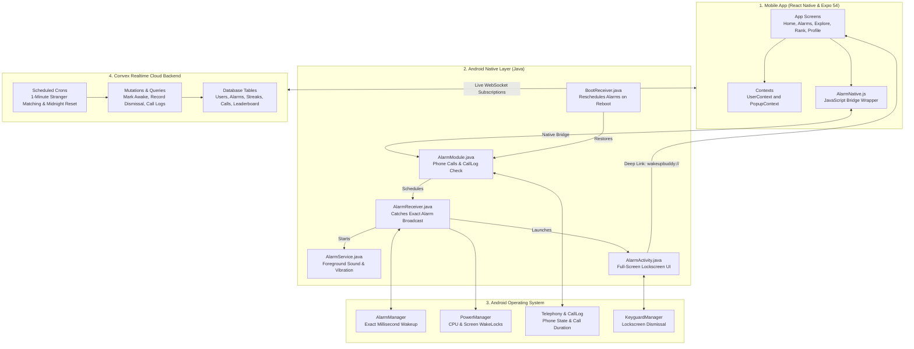
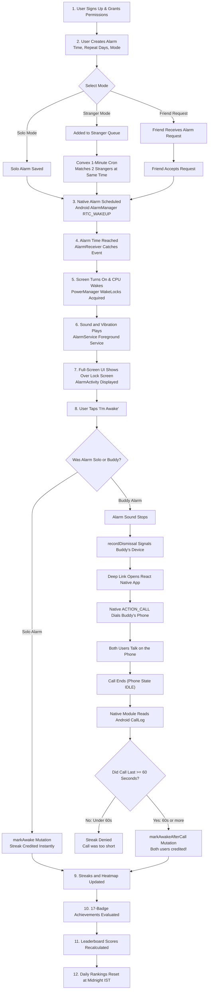
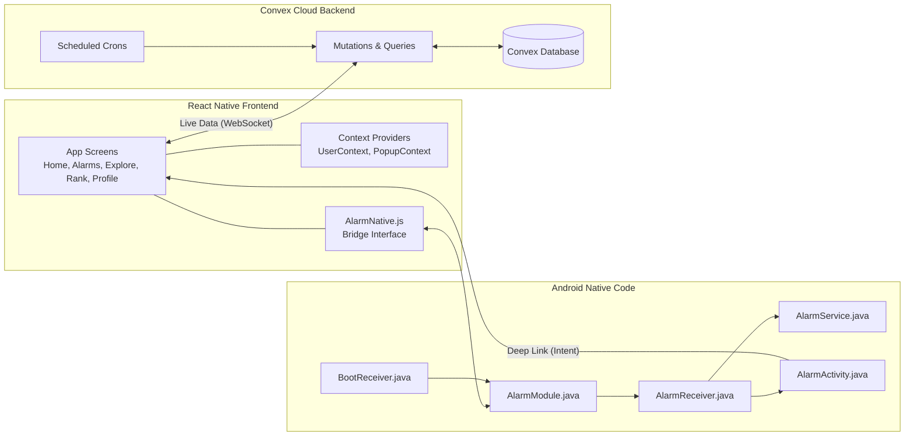
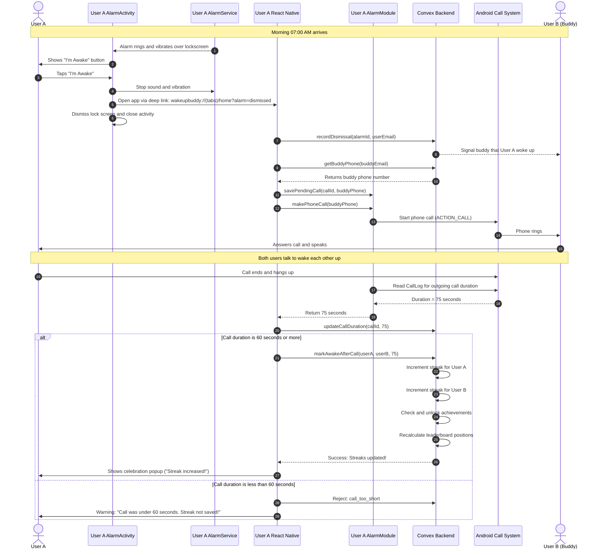
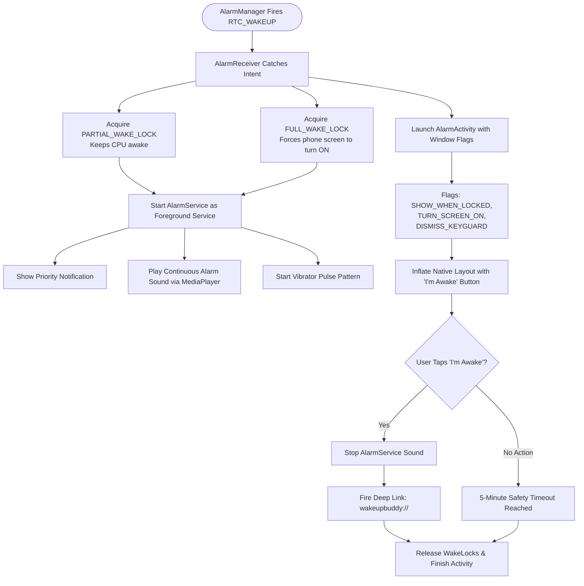
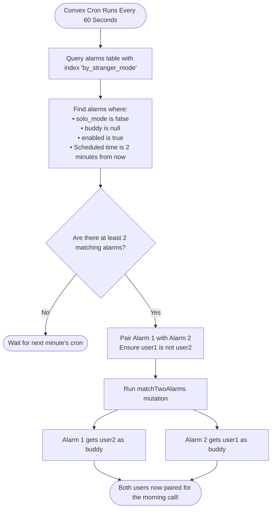
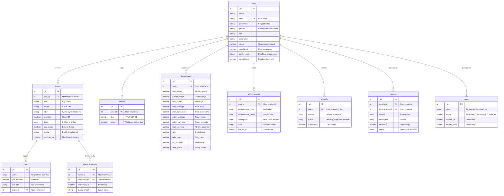
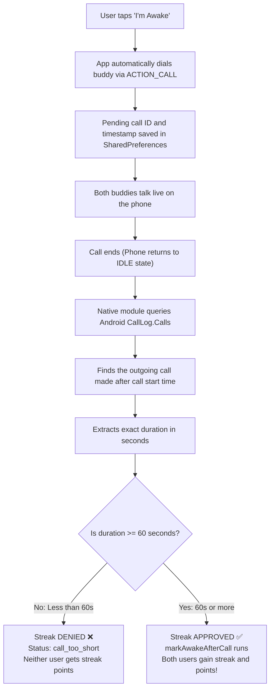

# 🌅 WakeupBuddy — Social Accountability Alarm Clock

> **Wake up together, stay accountable.**  
> WakeupBuddy makes waking up easy and fun by pairing you with a friend or a stranger. When your alarm rings, you and your buddy must talk on a real phone call for at least 60 seconds to prove you are out of bed. Build daily streaks, unlock badges, and climb the leaderboard!

---

[](https://reactnative.dev/)
[](https://expo.dev/)
[](https://convex.dev/)
[](https://developer.android.com/)
[](./LICENSE)

---

## 📑 Table of Contents

- [1. Why WakeupBuddy? (The Problem and the Solution)](#1-why-wakeupbuddy-the-problem-and-the-solution)
- [2. System Architecture](#2-system-architecture)
- [3. A to Z End-to-End Control Flow Diagram](#3-a-to-z-end-to-end-control-flow-diagram)
- [4. Visual Flowcharts and Diagrams](#4-visual-flowcharts-and-diagrams)
  - [4.1 Component Architecture Diagram](#41-component-architecture-diagram)
  - [4.2 Full A-to-Z Sequence Diagram](#42-full-a-to-z-sequence-diagram)
  - [4.3 Android Native Lock Screen Ringing Flowchart](#43-android-native-lock-screen-ringing-flowchart)
  - [4.4 Stranger Matching Engine Flowchart](#44-stranger-matching-engine-flowchart)
  - [4.5 Database Entity-Relationship (ER) Diagram](#45-database-entity-relationship-er-diagram)
- [5. Core Features](#5-core-features)
- [6. Screen Flow and Navigation](#6-screen-flow-and-navigation)
- [7. How Android Native Modules Work](#7-how-android-native-modules-work)
- [8. The 60-Second Anti-Cheating Call Verification](#8-the-60-second-anti-cheating-call-verification)
- [9. Points, Leaderboards and Streaks](#9-points-leaderboards-and-streaks)
- [10. Achievements Catalog (All 17 Badges)](#10-achievements-catalog-all-17-badges)
- [11. Android Permissions Explained](#11-android-permissions-explained)
- [12. Project Directory Structure](#12-project-directory-structure)
- [13. How to Run and Build Locally](#13-how-to-run-and-build-locally)
- [14. Safety, Reporting and Ban Appeals](#14-safety-reporting-and-ban-appeals)
- [15. Authors and Acknowledgments](#15-authors-and-acknowledgments)

---

## 1. Why WakeupBuddy? (The Problem and the Solution)

### The Problem: Why Regular Alarms Fail
Most people struggle to get out of bed with traditional alarm clocks:
- **The Snooze Trap**: When half-asleep, your brain is foggy (sleep inertia). Hitting "Snooze" is too easy because nobody is watching or waiting for you.
- **No Real Commitment**: Making a promise to yourself at night is easy to break in the morning when you are tired.
- **Broken Mornings**: Hitting snooze multiple times leads to rushing, stress, missed workouts, and feeling guilty.

### The Solution: Social Accountability
WakeupBuddy fixes this with human connection:
1. **Shared Waking**: You set an alarm with a friend or a matched stranger waking up at the same minute.
2. **Synchronized Rings**: Both phones ring at the same exact time with a full-screen alarm.
3. **Automated Phone Call**: As soon as you tap **"I'm Awake"**, the app immediately places a phone call to your buddy.
4. **Live Human Conversation**: Talking to another person forces your brain to wake up within seconds. You cannot sleep while speaking!
5. **The 60-Second Rule**: Both you and your buddy **must talk for at least 60 seconds** on the phone. If either person hangs up early, no streak points or badges are given.

---

## 2. System Architecture

WakeupBuddy uses four main layers working together:



---

## 3. A to Z End-to-End Control Flow Diagram

Here is what happens from the moment an alarm is set to when the streak is saved:



---

## 4. Visual Flowcharts and Diagrams

### 4.1 Component Architecture Diagram

This diagram shows how data flows across the application components:



---

### 4.2 Full A-to-Z Sequence Diagram

This sequence diagram details every single network and hardware call during an alarm event:



---

### 4.3 Android Native Lock Screen Ringing Flowchart

How the Android phone wakes up from deep sleep (Doze Mode) reliably:



---

### 4.4 Stranger Matching Engine Flowchart

How Convex pairs two random strangers waking up at the same minute:



---

### 4.5 Database Entity-Relationship (ER) Diagram

The complete database schema in Convex:



---

## 5. Core Features

- **Solo Alarms**: Standard alarms for days you want to wake up on your own.
- **Buddy Alarms**: Set an alarm linked with a friend. Both phones ring together.
- **Stranger Matching**: Wake up with someone new from around the world at the exact same minute.
- **Automated Phone Call**: Tapping "I'm Awake" instantly dials your buddy so you talk out loud.
- **60-Second Call Verification**: Android call logs verify you talked for at least 60 seconds before giving streak credit.
- **90-Day Activity Heatmap**: Interactive visual matrix on your home screen inspired by GitHub's contribution chart.
- **17 Unlockable Achievements**: Badges celebrating streaks, wakeup counts, early mornings, and buddy milestones.
- **Dual Leaderboards**:
  - **Daily Tab**: Resets every night at midnight—anyone can win today!
  - **Global Tab**: Long-term rankings based on streaks, consistency, and total wakeups.
- **DiceBear Avatars**: Fun, customized cartoon adventurer avatars generated automatically for each user.

---

## 6. Screen Flow and Navigation

The app is built with **Expo Router** and organized into clean tabs and screens:

```
app/
├── (tabs)/
│   ├── home.jsx        → Main dashboard with streaks, 90-day heatmap, upcoming alarms
│   ├── alarms.jsx      → List of your alarms with toggles, edit, and delete
│   ├── explore.jsx     → Search for users, send buddy requests, discover people
│   ├── rank.jsx        → Leaderboards (Daily Sprint tab & Global Marathon tab)
│   └── profile.jsx     → Your avatar, bio, total stats, and earned badges showcase
└── screens/
    ├── alarm-editor.jsx     → Create or edit alarms (time picker, repeat days, modes)
    ├── PermissionsGuide.jsx → Visual permission checklist for Android
    ├── notifications.jsx    → Social inbox for buddy requests and match alerts
    ├── my-buddies.jsx       → Your friends list and connection statuses
    ├── stats.jsx            → Head-to-head comparison stats with any buddy
    ├── account-details.jsx  → Edit profile, username, phone, and bio
    ├── premium.jsx          → Upgrade plan (unlimited stranger matches, ad-free)
    └── appeal.jsx           → Ban appeal form for users exceeding report limits
```

---

## 7. How Android Native Modules Work

Standard JavaScript timers cannot ring alarms when your phone is locked and sleeping overnight. Android uses **Doze Mode** to save battery by putting apps to sleep.

WakeupBuddy uses custom native Android Java code in `android/app/src/main/java/com/anonymous/WakeupBuddy/`:

1. **`AlarmReceiver.java`**:
   - Catches the alarm event from Android's `AlarmManager.setAlarmClock()`.
   - Acquires two **WakeLocks**:
     - `PARTIAL_WAKE_LOCK`: Keeps the phone CPU running at full speed.
     - `FULL_WAKE_LOCK`: Forces the physical screen to light up.
2. **`AlarmService.java`**:
   - Runs as a **Foreground Service** with maximum priority.
   - Loops the alarm ringtone using Android's `MediaPlayer` on the alarm audio channel.
   - Vibrates the phone hardware with a repeating pattern.
3. **`AlarmActivity.java`**:
   - Displays a clean native screen directly over the secure lock screen.
   - Uses Android window flags so you don't have to unlock your phone first:
     ```java
     setShowWhenLocked(true);
     setTurnScreenOn(true);
     ```
   - When you tap **"I'm Awake"**, it stops the music and sends a deep link (`wakeupbuddy://(tabs)/home?alarm=dismissed`) to open the React Native app.
4. **`BootReceiver.java`**:
   - Whenever your phone restarts, it reads saved alarms from `SharedPreferences` and re-registers them with Android so no alarm is lost.
5. **`AlarmModule.java`**:
   - React Native bridge module that places outbound phone calls and checks the Android `CallLog` to verify call duration.

---

## 8. The 60-Second Anti-Cheating Call Verification

To make sure users actually get out of bed rather than hanging up immediately, WakeupBuddy checks the Android system call log:



---

## 9. Points, Leaderboards and Streaks

### 9.1 Global Leaderboard (Long-Term Dedication)
Ranks users based on total consistency over time:

$$\text{Global Points} = (\text{Max Streak} \times 27) + (\text{Total Wakeups} \times 53)$$

- **Current Streak Bonuses**: Extra multipliers for maintaining long streaks (1.5x at 7 days, 2x at 14 days, 3x at 30 days, 5x at 90 days).
- **Max Streak Lifetime Bonus**: Extra points for hitting personal best records (+50 for 1 week, +100 for 2 weeks, +250 for 1 month, +1,000 for 90 days).
- **Consistency Ratio**: Rewards users who wake up consistently without skipping days.

### 9.2 Daily Leaderboard (Daily Sprint)
Ranks users solely on **today's** performance:
1. **Primary Sort**: Today's wakeups count (higher is better).
2. **Secondary Tie-Breaker**: Today's phone call time (longer talk time wins).
3. **Daily Reset**: Resets to zero every night at **Midnight IST (18:30 UTC)** via an automated Convex cron.

---

## 10. Achievements Catalog (All 17 Badges)

| Badge Name | Category | How to Unlock | Icon |
|:---|:---|:---|:---|
| **Getting Started** | Streak | Keep a 3-day wake streak | `flame-outline` |
| **7 Day Streak** | Streak | Keep a 7-day wake streak | `flame` |
| **Two Week Warrior**| Streak | Keep a 14-day wake streak | `flame` |
| **Monthly Master** | Streak | Keep a 30-day wake streak | `trophy` |
| **Century Club** | Streak | Keep a 100-day wake streak | `medal` |
| **First Wakeup** | Wakeup | Complete your first wake-up | `sunny-outline` |
| **Early Riser** | Wakeup | Complete 10 total wake-ups | `sunny` |
| **Morning Person** | Wakeup | Complete 50 total wake-ups | `star` |
| **Wakeup Legend** | Wakeup | Complete 100 total wake-ups | `star` |
| **Early Bird** | Early | Wake up before your scheduled alarm time | `alarm` |
| **Super Early Bird**| Early | Wake up early 5 times | `alarm` |
| **First Buddy** | Buddy | Connect with your first wake buddy | `people-outline`|
| **Social Butterfly**| Buddy | Connect with 5 different wake buddies | `people` |
| **Buddy Helper** | Buddy | Complete a 60s+ wake-up call helping a friend | `hand-left` |
| **Weekend Warrior** | Special | Wake up on time on both Saturday and Sunday | `calendar` |
| **Night Owl Reformed**| Special| Switch from late alarms to early morning alarms | `moon` |
| **Consistent Week** | Special | Wake up at the exact same minute for 7 days | `time` |

---

## 11. Android Permissions Explained

WakeupBuddy includes an interactive **Permissions Guide screen** (`PermissionsGuide.jsx`) that checks and guides you through granting each permission:

| Permission | Why It Is Needed | What Happens If Denied |
|:---|:---|:---|
| **Exact Alarms** (`SCHEDULE_EXACT_ALARM`) | Rings the alarm at the exact minute without delay | Alarm might ring 10–15 minutes late |
| **Ignore Battery Optimizations** | Prevents Android from killing the app while you sleep | Alarm will fail to ring overnight |
| **Draw Over Other Apps** (`SYSTEM_ALERT_WINDOW`)| Shows the alarm screen when other apps are open | Cannot display the full-screen alarm |
| **Full-Screen Intent** (`USE_FULL_SCREEN_INTENT`)| Displays the alarm directly over the lock screen on Android 14+ | Only shows a small notification banner |
| **Make Phone Calls** (`CALL_PHONE`) | Automatically dials your buddy when you tap "I'm Awake" | Falls back to opening phone dialer manually |
| **Read Call Log** (`READ_CALL_LOG`) | Checks that the phone call lasted at least 60 seconds | Cannot verify call length; streak is not saved |
| **Phone State** (`READ_PHONE_STATE`) | Detects when you answer and hang up the phone call | Cannot detect when call starts or ends |

---

## 12. Project Directory Structure

```
WakeupBuddy/
├── android/                         # Android native project files
│   └── app/src/main/
│       ├── AndroidManifest.xml      # Android permissions & services registration
│       ├── res/layout/              # Native XML layouts for lockscreen alarm
│       └── java/com/anonymous/WakeupBuddy/
│           ├── AlarmActivity.java   # Lockscreen alarm UI
│           ├── AlarmModule.java     # React Native bridge & CallLog duration reader
│           ├── AlarmPackage.java    # Native package registrar
│           ├── AlarmReceiver.java   # Catches AlarmManager triggers with WakeLocks
│           ├── AlarmService.java    # Foreground service playing audio & vibration
│           ├── BootReceiver.java    # Reschedules alarms on device reboot
│           ├── MainActivity.kt      # Main React Native activity
│           └── MainApplication.kt   # Native application entry
├── app/                             # Expo Router pages
│   ├── (tabs)/                      # Bottom tab screens (Home, Alarms, Explore, Rank, Profile)
│   ├── screens/                     # Stack screens (Alarm Editor, Notifications, Stats, Appeal)
│   ├── ads/                         # Mobile banner ad integration
│   ├── native/                      # JavaScript bridge to AlarmModule
│   ├── user/[id].jsx                # Public profile view for other users
│   ├── login.jsx                    # Login page
│   └── signup.jsx                   # Signup and avatar generation page
├── components/                      # Reusable UI components (AppText, ProfilePic)
├── contexts/                        # React contexts (UserContext, PopupContext)
├── convex/                          # Convex backend functions
│   ├── schema.js                    # Database schema (10 tables)
│   ├── alarms.js                    # Alarm CRUD & queries
│   ├── crons.js                     # 1-min stranger matching & midnight daily reset
│   ├── matching.js                  # Stranger pairing algorithm
│   ├── streaks.js                   # Streak increments & markAwake logic
│   ├── calls.js                     # Call records & buddy stats
│   ├── leaderboard.js               # Leaderboard calculations
│   ├── achievements.js              # 17-badge achievement evaluator
│   ├── friends.js                   # Friends & buddy requests
│   └── users.js                     # User authentication & profiles
├── package.json                     # Dependencies & scripts
└── tsconfig.json                    # TypeScript configuration
```

---

## 13. How to Run and Build Locally

### Prerequisites
- **Node.js**: Version 20 or newer
- **Android Studio**: With Android SDK & command-line tools installed
- **Java (JDK)**: OpenJDK 17
- **A real Android device**: Recommended for testing actual phone calls and lock screen alarms
- **Convex Account**: Free account at [convex.dev](https://convex.dev)

### Step-by-Step Setup

1. **Clone the code**:
   ```bash
   git clone https://github.com/AaryaBalan/WakeupBuddy.git
   cd WakeupBuddy
   ```

2. **Install packages**:
   ```bash
   npm install
   ```

3. **Start Convex backend**:
   ```bash
   npx convex dev
   ```
   *This connects to your Convex account and sets up your `.env.local` automatically.*

4. **Verify your `.env.local` file**:
   ```env
   EXPO_PUBLIC_CONVEX_URL=https://your-project.convex.cloud
   ```

5. **Deploy Convex backend (tables & crons)**:
   ```bash
   npx convex deploy
   ```

6. **Run on your Android phone**:
   *(Make sure your phone is plugged in via USB and USB Debugging is turned ON in Developer Options)*
   ```bash
   npx expo run:android
   ```

---

## 14. Safety, Reporting and Ban Appeals

To ensure a safe and respectful community:
- **Reporting Users**: You can report any user from their profile screen if they behave inappropriately during calls.
- **Automatic Ban Threshold**: If a user receives more than **3 reports**, their account is automatically restricted from stranger matching.
- **Appeal Process**: Banned users can submit an appeal through `screens/appeal.jsx`. An admin reviews the appeal in the `appeals` table to restore or permanently ban the account.

---

## 15. Authors and Acknowledgments

### Authors
- **Aarya B** — [@AaryaBalan](https://github.com/AaryaBalan)
- **Akshaya T** — [@Akshayathiru](https://github.com/Akshayathiru)

### Built With
- [Expo](https://expo.dev/) — React Native framework & developer tools
- [Convex](https://convex.dev/) — Real-time reactive cloud database
- [DiceBear](https://dicebear.com/) — Avatar generation API
- [Ionicons](https://ionic.io/ionicons) — Clean vector icons

---

<p align="center">
  <b>WakeupBuddy</b> • <i>Wake up together, stay accountable.</i>
</p>
