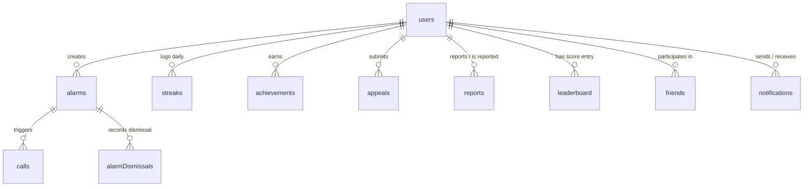

# 🗄️ WakeupBuddy - Database Schema Reference

This document provides a comprehensive technical reference for all **11 tables** defined in the Convex backend database (`convex/schema.js`), including field schemas, data types, indexes, and entity relationships.

---

## Entity Relationship Overview

---

## Table 1: `users`
Represents user accounts, profile metadata, and security credentials.

| Field Name | Type | Optional | Description |
| :--- | :--- | :---: | :--- |
| `name` | `v.string()` | No | Full display name of the user |
| `email` | `v.string()` | No | Unique email address (primary identity) |
| `password` | `v.string()` | No | Salted bcrypt hash of the user password |
| `phone` | `v.string()` | No | Mobile phone number used for morning wake-up calls |
| `username` | `v.string()` | No | Unique handle (defaults to email prefix) |
| `bio` | `v.string()` | Yes | Optional personal bio or wake-up motto |
| `streak` | `v.number()` | Yes | Current consecutive day wake streak |
| `maxStreak` | `v.number()` | Yes | Historical peak wake streak |
| `profile_code`| `v.string()` | Yes | Avatar seed string used for DiceBear avatar generation |
| `reportCount` | `v.number()` | Yes | Total validated user reports against this account |

### Indexes
- `by_email` on `['email']`: Used for instant authentication lookups and profile matching.

---

## Table 2: `alarms`
Stores configured alarms, repetition schedules, and stranger match state.

| Field Name | Type | Optional | Description |
| :--- | :--- | :---: | :--- |
| `time` | `v.string()` | No | Time formatted as `"H:MM"` or `"HH:MM"` (e.g., `"06:30"`) |
| `ampm` | `v.string()` | No | Meridian indicator (`"AM"` or `"PM"`) |
| `label` | `v.string()` | No | User-assigned label (e.g., `"Gym Wakeup"`) |
| `enabled` | `v.boolean()` | No | Active state of the alarm toggle |
| `days` | `v.array(v.number())` | No | Days active (`0` = Monday ... `6` = Sunday) |
| `user_id` | `v.id('users')` | No | ID of the user who owns this alarm |
| `solo_mode` | `v.boolean()` | No | `true` if solo alarm, `false` if buddy/stranger alarm |
| `buddy` | `v.union(v.string(), v.null())`| No | Buddy email address, or `null` if awaiting match |
| `matched_at` | `v.number()` | Yes | Epoch timestamp when stranger match was finalized |

### Indexes
- `by_user` on `['user_id']`: Lists all alarms for a given user.
- `by_time_ampm` on `['time', 'ampm']`: Used by matchmaking queries to find users waking up at the exact same minute.
- `by_stranger_mode` on `['solo_mode', 'enabled']`: Rapidly finds unmatched enabled stranger alarms.

---

## Table 3: `alarmDismissals`
Tracks real-time alarm dismissals to notify connected buddies.

| Field Name | Type | Optional | Description |
| :--- | :--- | :---: | :--- |
| `alarm_id` | `v.id('alarms')` | No | Reference to the alarm that rang |
| `dismissed_by` | `v.id('users')` | No | User who tapped "I'm Awake" |
| `dismissed_at` | `v.number()` | No | Epoch timestamp of the dismissal event |
| `buddy_email` | `v.string()` | Yes | Email of the buddy who should be notified |

### Indexes
- `by_alarm` on `['alarm_id']`: Fetch dismissal records for a specific alarm.
- `by_buddy` on `['buddy_email', 'dismissed_at']`: Real-time query to check if a buddy recently dismissed their alarm.

---

## Table 4: `calls`
Records all mutual phone calls initiated between buddies after alarm dismissals.

| Field Name | Type | Optional | Description |
| :--- | :--- | :---: | :--- |
| `users` | `v.array(v.id('users'))` | No | Tuple `[callerId, calleeId]` of participating users |
| `call_duration` | `v.number()` | No | Duration in seconds (verified via Android call log) |
| `call_time` | `v.string()` | No | ISO timestamp string when call was initiated |
| `alarm_id` | `v.id('alarms')` | No | Foreign key linking to the alarm |

### Indexes
- `by_user` on `['users']`: Used to compute buddy history, call stats, and rankings.
- `by_alarm` on `['alarm_id']`: Connects call metrics directly to scheduled alarms.

---

## Table 5: `streaks`
Daily granular wake-up logs used for computing streaks, heatmaps, and chart analytics.

| Field Name | Type | Optional | Description |
| :--- | :--- | :---: | :--- |
| `user_id` | `v.id('users')` | No | Foreign key to `users` |
| `date` | `v.string()` | No | Calendar date string (`"YYYY-MM-DD"`) in user local time |
| `count` | `v.number()` | No | Number of successful wake-ups recorded on that date |

### Indexes
- `by_user` on `['user_id']`: Collects full wake history for heatmaps and stats.
- `by_user_date` on `['user_id', 'date']`: Fast check if user already woke up today.

---

## Table 6: `leaderboard`
Precomputed scoring metrics for daily and all-time global competitive leaderboards.

| Field Name | Type | Optional | Description |
| :--- | :--- | :---: | :--- |
| `user_id` | `v.id('users')` | No | User ID |
| `total_points` | `v.number()` | No | Cumulative global score |
| `current_streak` | `v.number()` | No | Active streak length |
| `max_streak` | `v.number()` | No | All-time highest streak |
| `total_wakeups` | `v.number()` | No | Cumulative wake-up count |
| `total_days_active`| `v.number()` | No | Unique count of days with at least 1 wake-up |
| `streak_points` | `v.number()` | No | Points derived from current streak multipliers |
| `max_streak_points`| `v.number()` | No | Points derived from max streak bonuses |
| `consistency_points`| `v.number()` | No | Points derived from active regularity ratio |
| `wakeup_points` | `v.number()` | No | Points derived from wake-up volume |
| `today_wakeups` | `v.number()` | Yes | Wake-up count today (resets at midnight IST) |
| `today_call_time` | `v.number()` | Yes | Call duration today in seconds (resets at midnight IST) |
| `total_call_time` | `v.number()` | Yes | All-time call duration in seconds |
| `rank` | `v.number()` | Yes | Global ranking position (1 = highest) |
| `daily_rank` | `v.number()` | Yes | Daily ranking position |
| `last_updated` | `v.number()` | No | Epoch timestamp of last calculation |
| `daily_points` | `v.number()` | Yes | Points earned today |
| `weekly_points` | `v.number()` | Yes | Points earned in current week |
| `monthly_points` | `v.number()` | Yes | Points earned in current month |

### Indexes
- `by_user` on `['user_id']`
- `by_points` on `['total_points']`
- `by_rank` on `['rank']`
- `by_daily_rank` on `['daily_rank']`

---

## Table 7: `achievements`
Unlocked achievement badges earned by users.

| Field Name | Type | Optional | Description |
| :--- | :--- | :---: | :--- |
| `user_id` | `v.id('users')` | No | User ID |
| `achievement_type`| `v.string()` | No | Key (e.g., `'streak_7'`, `'early_bird'`, `'first_buddy'`) |
| `achievement_name`| `v.string()` | No | Human-readable name |
| `description` | `v.string()` | No | How the badge was earned |
| `icon` | `v.string()` | No | Ionicons glyph name |
| `earned_at` | `v.number()` | No | Epoch timestamp when unlocked |
| `metadata` | `v.object(...)`| Yes | Optional details (e.g., `streak_count`, `buddy_count`) |

### Indexes
- `by_user` on `['user_id']`
- `by_type` on `['achievement_type']`
- `by_user_type` on `['user_id', 'achievement_type']`: Prevents awarding the same badge twice.

---

## Table 8: `friends`
Social connections and friend requests.

| Field Name | Type | Optional | Description |
| :--- | :--- | :---: | :--- |
| `users` | `v.array(v.id('users'))` | No | Pair `[senderId, receiverId]` |
| `status` | `v.number()` | No | `0` = Pending, `1` = Approved, `-1` = Rejected |
| `created_at` | `v.number()` | No | Timestamp of initial request |
| `friends_since` | `v.number()` | Yes | Timestamp of approval |

### Indexes
- `by_users` on `['users']`
- `by_status` on `['status']`

---

## Table 9: `notifications`
System and social alerts (e.g., incoming buddy alarm requests).

| Field Name | Type | Optional | Description |
| :--- | :--- | :---: | :--- |
| `alarm_time` | `v.string()` | No | Time of the proposed alarm |
| `created_by` | `v.id('users')` | No | Sender user ID |
| `with_whom` | `v.string()` | No | Receiver user email |
| `time` | `v.string()` | No | Creation timestamp ISO |
| `status` | `v.number()` | No | `0` = Pending, `1` = Accepted, `-1` = Rejected |
| `ampm` | `v.string()` | No | `"AM"` or `"PM"` |

### Indexes
- `by_creator` on `['created_by']`
- `by_receiver` on `['with_whom']`

---

## Table 10: `reports`
User moderation reports against abusive or inappropriate behavior.

| Field Name | Type | Optional | Description |
| :--- | :--- | :---: | :--- |
| `reporterId` | `v.id('users')` | No | ID of user submitting report |
| `reportedUserId` | `v.id('users')` | No | ID of reported user |
| `reason` | `v.string()` | No | Violation category |
| `description` | `v.string()` | Yes | Additional details |
| `createdAt` | `v.number()` | No | Timestamp |
| `status` | `v.string()` | Yes | `'pending'`, `'reviewed'`, `'resolved'` |

### Indexes
- `by_reporter` on `['reporterId']`
- `by_reported` on `['reportedUserId']`
- `by_status` on `['status']`

---

## Table 11: `appeals`
Formal requests from banned or flagged users to reinstate their account.

| Field Name | Type | Optional | Description |
| :--- | :--- | :---: | :--- |
| `userId` | `v.id('users')` | No | ID of banned user |
| `reason` | `v.string()` | No | Detailed justification for unban |
| `status` | `v.string()` | No | `'pending'`, `'approved'`, `'rejected'` |
| `submittedAt` | `v.number()` | No | Submission timestamp |
| `reviewedAt` | `v.number()` | Yes | Review timestamp |
| `reviewedBy` | `v.string()` | Yes | Admin reviewer identifier |

### Indexes
- `by_user` on `['userId']`
