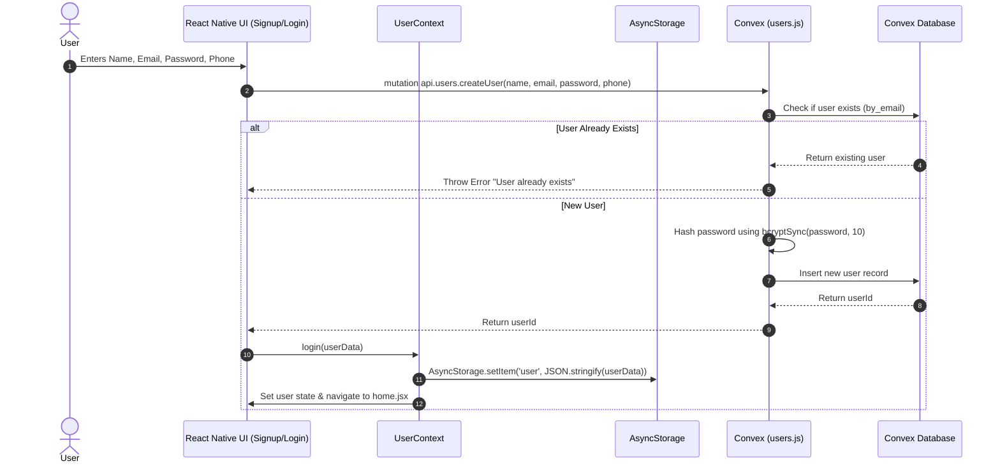
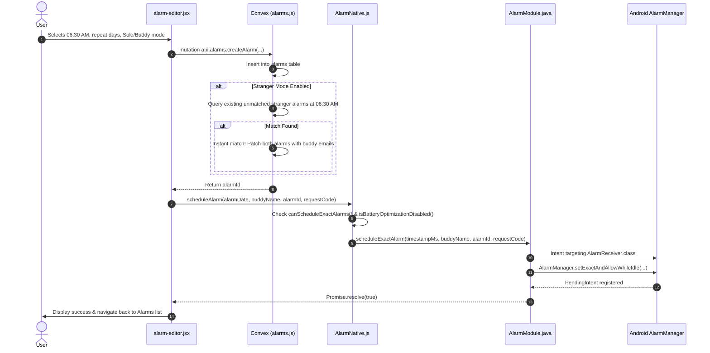
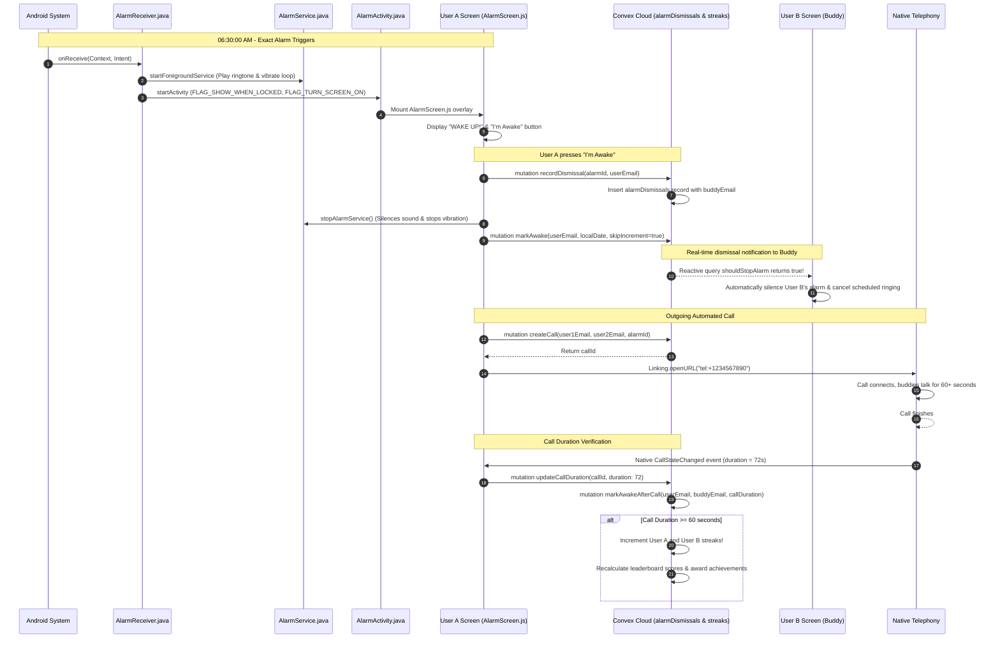
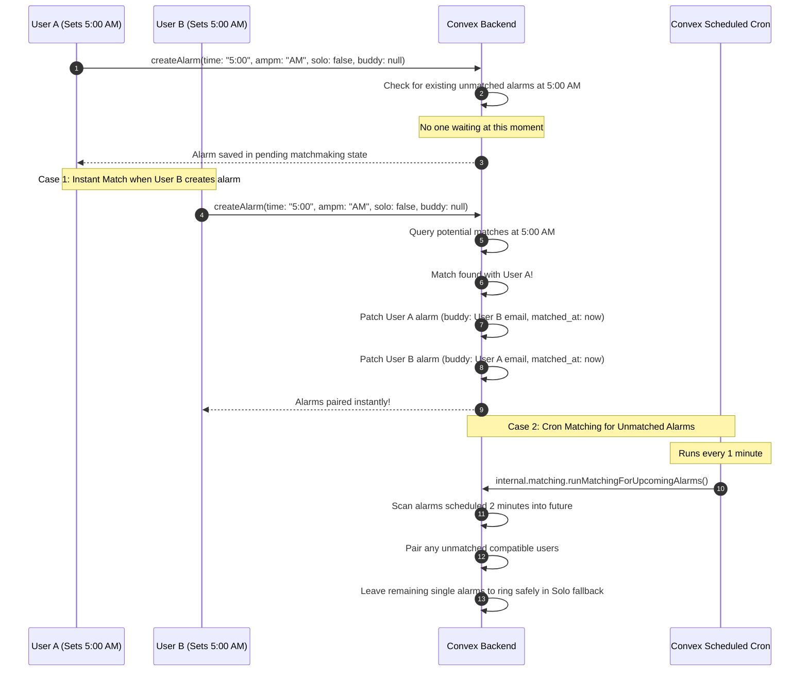

# 🔄 WakeupBuddy - End-to-End Data Flows

This document details the exact sequence of events, data structures, and lifecycle interactions across the client, native Android bridge, and Convex backend.

---

## 1. User Registration & Authentication Flow

---

## 2. Alarm Creation & Native Scheduling Flow

---

## 3. Morning Alarm Execution & Synchronized Wake-Up Call Protocol

---

## 4. Stranger Matching Flow (Instant vs Cron)

