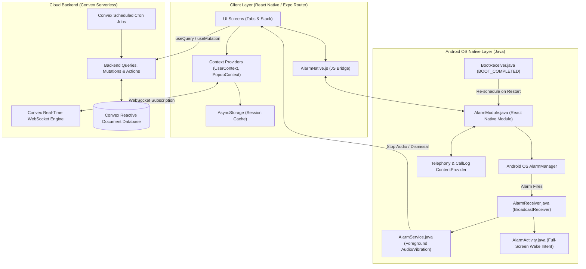

# 🏗️ WakeupBuddy - System Architecture Overview

This document presents the full-stack architecture of WakeupBuddy, spanning the React Native client, Android OS native bridging, and the Convex real-time serverless cloud backend.

---

## High-Level Architecture Diagram

---

## Tier-by-Tier Breakdown

### 1. Presentation & State Layer (React Native / Expo Router)
- **Framework**: React Native 0.76+ powered by Expo SDK 52.
- **Navigation Engine**: Expo Router (file-based routing with tab bar layouts, stack screens, and modal dialogs).
- **Core State Stores**:
  - `UserContext.jsx`: Manages logged-in user state, authentication credentials, profile metadata, ban verification, and syncs local storage with Convex reactive queries.
  - `PopupContext.jsx`: Provides an application-wide modal system for custom alerts, confirmations, and congratulations overlays.
  - `AsyncStorage`: Offline-first caching for user tokens and active session variables.

### 2. Native Android Integration Layer (Java)
Standard JavaScript timer functions (`setTimeout`, `setInterval`) and web APIs are throttled or terminated when an Android device enters sleep mode (Doze Mode). To guarantee alarm execution, WakeupBuddy utilizes a custom Android native package (`AlarmPackage` / `AlarmModule`):

- **`AlarmModule.java`**: The React Native bridge module exposing methods to schedule exact alarms, request system permissions, trigger phone calls, and query call logs.
- **`AlarmReceiver.java`**: An Android `BroadcastReceiver` that triggers when the OS `AlarmManager` fires at the millisecond-accurate timestamp.
- **`AlarmService.java`**: An Android `ForegroundService` that binds continuous ringtone audio (`RingtoneManager.TYPE_ALARM`) and continuous haptic vibration loops.
- **`AlarmActivity.java`**: A native Android Activity configured with `FLAG_SHOW_WHEN_LOCKED`, `FLAG_TURN_SCREEN_ON`, and `FLAG_KEEP_SCREEN_ON` to forcefully turn on the display even if the device is pinned or locked.
- **`BootReceiver.java`**: Re-registers scheduled alarms whenever the physical device reboots (`ACTION_BOOT_COMPLETED`).

### 3. Real-Time Cloud Backend Layer (Convex)
WakeupBuddy is powered by **Convex**, a serverless, reactive database platform:
- **WebSocket Reactivity**: All client reads are reactive subscriptions. When a user updates their alarm or dismisses a morning call, all linked clients re-render automatically without manual polling.
- **Transactional ACID Mutations**: Concurrent operations (e.g., two strangers claiming the same alarm match simultaneously) execute inside isolated database transactions to prevent race conditions.
- **Automated Cron Jobs**: Background workers run every minute for upcoming stranger matchmaking and daily at midnight IST for leaderboard resets.
