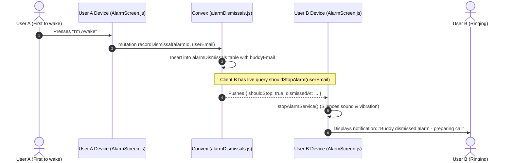

# 🔕 Convex Backend - Alarm Dismissals Reference (`convex/alarmDismissals.js`)

This document describes the real-time dismissal synchronization system that silences a buddy's alarm automatically when their partner taps "I'm Awake".

---

## 1. System Overview

When two buddies wake up together, their alarms ring simultaneously. Whichever buddy wakes up first and presses **"I'm Awake"** immediately signals the other phone via Convex so the second phone doesn't continue blaring while the incoming call connects.



---

## 2. `recordDismissal` (Mutation)

### Purpose
Records that a user dismissed their alarm, looks up the associated buddy from the alarm document, and inserts an event into `alarmDismissals`.

### Arguments
| Parameter | Type | Required | Description |
| :--- | :--- | :---: | :--- |
| `alarmId` | `v.id("alarms")` | Yes | ID of the ringing alarm |
| `userEmail` | `v.string()` | Yes | Email of the user who dismissed |

### Execution Logic
1. Retrieves the alarm record: `ctx.db.get(args.alarmId)`. Throws error if missing.
2. Retrieves user record: `users.by_email` query for `args.userEmail`.
3. Inserts document into `alarmDismissals`:
   ```javascript
   {
       alarm_id: args.alarmId,
       dismissed_by: user._id,
       dismissed_at: Date.now(),
       buddy_email: alarm.buddy || undefined
   }
   ```
4. Returns `{ success: true, dismissalId, buddyEmail: alarm.buddy }`.

---

## 3. `checkBuddyDismissed` (Query)

### Purpose
Checks whether the current user's buddy has dismissed this specific alarm within the last **2 minutes**.

### Arguments
| Parameter | Type | Required | Description |
| :--- | :--- | :---: | :--- |
| `userEmail` | `v.string()` | Yes | Calling user email |
| `alarmId` | `v.id("alarms")` | Yes | Alarm ID |

### Execution Logic
1. Retrieves the alarm. If `alarm.buddy` is null, returns `null`.
2. Calculates cutoff threshold: `Date.now() - 2 * 60 * 1000` (2 minutes).
3. Queries `alarmDismissals` on index `by_alarm` where `dismissed_at >= cutoff`.
4. Finds a record where `buddy_email === args.userEmail`.
5. Returns matching dismissal document or `null`.

---

## 4. `shouldStopAlarm` (Query)

### Purpose
A real-time reactive subscription polled/observed by `AlarmScreen.js`. As soon as any connected buddy dismisses an alarm intended for the calling user within the last 2 minutes, this query reactively returns `shouldStop: true`.

### Arguments
| Parameter | Type | Required | Description |
| :--- | :--- | :---: | :--- |
| `userEmail` | `v.string()` | Yes | Current user's email |

### Execution Logic
1. Finds user by email.
2. Queries `alarmDismissals` using index `by_buddy` filtering on `buddy_email == args.userEmail` and `dismissed_at >= Date.now() - 2 minutes`.
3. If matching dismissals exist:
   - Selects the latest dismissal record.
   - Returns:
     ```typescript
     {
         shouldStop: true,
         dismissedAt: number,
         alarmId: Id<"alarms">
     }
     ```
4. Otherwise returns `{ shouldStop: false }`.
