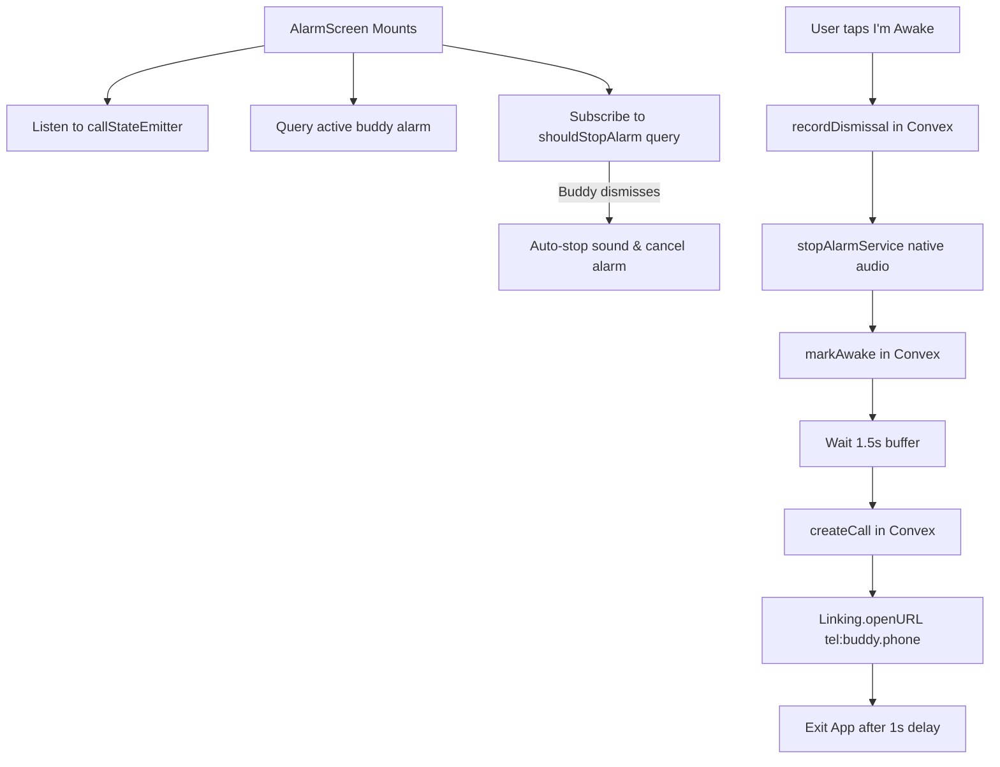

# 🧩 Frontend - Components Catalog Reference

This document details the shared, reusable UI components within the WakeupBuddy frontend codebase.

---

## 1. `AlarmScreen.js` (`app/components/AlarmScreen.js`)

### Purpose
The **most critical user interface in the application**. This component renders when an exact alarm triggers. It provides the full-screen visual wake-up UI, plays sound, coordinates real-time mutual dismissal, marks the user awake, and launches the automated phone call.



### Key Logic & Hooks
1. **Call State Listener**:
   ```javascript
   useEffect(() => {
       const unsubscribe = subscribeToCallState(async (event) => {
           if (event.status === 'ended' && callIdRef.current && event.duration) {
               await updateCallDuration({
                   callId: callIdRef.current,
                   duration: Math.round(event.duration)
               });
           }
       });
       return () => unsubscribe();
   }, []);
   ```
2. **Mutual Dismissal Listener (`shouldStopAlarm`)**:
   ```javascript
   const shouldStop = useQuery(api.alarmDismissals.shouldStopAlarm, { userEmail: user.email });
   useEffect(() => {
       if (shouldStop?.shouldStop && !alarmStoppedRef.current) {
           alarmStoppedRef.current = true;
           stopAlarmService();
           cancelAlarm(1001);
       }
   }, [shouldStop]);
   ```
3. **The "I'm Awake" Handler (`handleImAwake`)**:
   - Records dismissal via `api.alarmDismissals.recordDismissal`.
   - Calls `stopAlarmService()` and `cancelAlarm(1001)`.
   - Calls `api.streaks.markAwake`. If a buddy is present, sets `skipIncrement: true`.
   - Pauses for a 1.5-second buffer to let the buddy's device silence.
   - Logs call record via `api.calls.createCall`.
   - Launches cellular phone dialer via `Linking.openURL('tel:${buddy.phone}')`.
   - Gracefully exits the alarm screen via `BackHandler.exitApp()`.

---

## 2. `Popup.jsx` (`app/components/Popup.jsx`)

### Purpose
Provides a standardized modal dialog system across all screens, powered by `PopupContext`.

### Features
- Animated modal presentation.
- Customizable icons (`success`, `warning`, `error`, `trophy`).
- Dynamic button actions (Confirm, Cancel, Custom handlers).
- Themed dark-mode styling with accent highlights.

---

## 3. `ProfilePic.jsx` (`components/ProfilePic.jsx`)

### Purpose
Renders a consistent, high-resolution user avatar using the **DiceBear API**.

### Implementation
- Takes `profileCode` (or defaults to email address) and `size`.
- Generates an SVG/PNG avatar URL using the `bottts` or `fun-emoji` avatar collection:
  ```
  https://api.dicebear.com/7.x/bottts/png?seed=${encodeURIComponent(profileCode)}
  ```
- Gracefully handles loading and image caching.

---

## 4. `AppText.jsx` (`components/AppText.jsx`)

### Purpose
Typography abstraction that wraps React Native's `<Text>` component. Guarantees font consistency, letter spacing, line height, and automatic theme color resolution across Android and iOS.

---

## 5. Ad Components (`app/ads/BannerAds.jsx` & `InterstitialAds.jsx`)

### Purpose
Provides non-intrusive monetization containers:
- **`BannerAds.jsx`**: Bottom-anchored banner ad rendered on free-tier screens.
- **`InterstitialAds.jsx`**: Full-screen interstitial triggered occasionally after alarm creation or milestone views.
