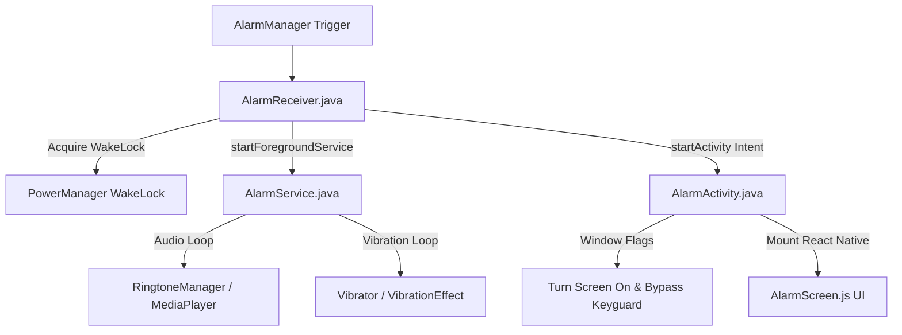

# ⚙️ Android Native - Services & Receivers Reference

This document details the background components, receivers, wakelocks, and native activities that guarantee alarm reliability on Android.

---

## 1. Native Execution Architecture

---

## 2. Component Specifications

### 2.1 `AlarmReceiver.java` (BroadcastReceiver)
- **Role**: Receives the pending intent fired by Android `AlarmManager`.
- **Key Responsibilities**:
  - Acquires a temporary `PowerManager.PARTIAL_WAKE_LOCK` to keep the CPU awake while starting services.
  - Starts `AlarmService` via `ContextCompat.startForegroundService()`.
  - Fires an explicit Intent with `Intent.FLAG_ACTIVITY_NEW_TASK` to launch `AlarmActivity`.

### 2.2 `AlarmService.java` (Foreground Service)
- **Role**: Plays the loud alarm audio and vibrates the phone continuously until dismissed.
- **Key Implementation Details**:
  - Posts an ongoing foreground notification (`NotificationCompat.Builder`) to satisfy Android background execution limits.
  - Plays the default alarm sound via `RingtoneManager.getDefaultUri(RingtoneManager.TYPE_ALARM)`.
  - Sets audio attributes to `AudioAttributes.USAGE_ALARM` to ensure sound plays even if the phone is set to silent or Do Not Disturb.
  - Drives continuous vibration patterns using `Vibrator` or `VibrationEffect.createWaveform()`.

### 2.3 `AlarmActivity.java` (Native Full-Screen Activity)
- **Role**: Overrides Android lock screens so the user sees the alarm UI immediately.
- **Window Flags**:
  - `WindowManager.LayoutParams.FLAG_SHOW_WHEN_LOCKED`: Displays over pin/pattern/fingerprint lock screens.
  - `WindowManager.LayoutParams.FLAG_TURN_SCREEN_ON`: Forces the physical display backlight to turn on.
  - `WindowManager.LayoutParams.FLAG_KEEP_SCREEN_ON`: Prevents the screen from timing out while ringing.
  - Calls `setShowWhenLocked(true)` and `setTurnScreenOn(true)` on Android 8.0+ (API 26+).

### 2.4 `BootReceiver.java` (BroadcastReceiver)
- **Role**: Listens for `android.intent.action.BOOT_COMPLETED`.
- **Behavior**: When an Android device powers off or restarts, OS alarms in `AlarmManager` are cleared by the system. `BootReceiver` triggers on startup and reads saved alarms from storage to re-register them with `AlarmManager`.
